<picture>
  <source media="(max-width: 600px)" srcset="https://raw.githubusercontent.com/SujanTheMagician/SujanTheMagician/main/assets/hero-mobile.svg" />
  
</picture>

  
  
  

## About

I'm a frontend developer intern at **ATIUM Sports** (Scermlind Healthcare Innovations Private Limited), where I build reusable UI components and connect them to backend APIs. I study B.Tech CSE (AI & ML) at AMET University × Kalvium, and I lead a team of 12 first-year students building web apps. Outside work I built [**Squad Hub**](https://github.com/SujanTheMagician/Squad-Hub), the private Android app for my batch's 78 students and staff.

## What I work on at ATIUM Sports

<picture>
  <source media="(max-width: 600px)" srcset="https://raw.githubusercontent.com/SujanTheMagician/SujanTheMagician/main/assets/atium-work-mobile.svg" />
  
</picture>

**Web platform** — the sports-science platform used by coaches, managers and practitioners

- **Competitions:** team and multi-athlete roster selection, quick competition creation, results grids
- **Calendar:** all-day events, a Google Calendar–style schedule bar, My view / Team view filters
- **Role home screens:** redesigned dashboards for coaches, managers and sports-science specialists
- **Training & load:** a revamped training report, and strain and monotony trends on the load dashboard
- **Files & forms:** a smoother file browser, rename-before-upload, and fixes to forms and attendance

**ATIUM Assets** — the internal mobile app for tracking equipment

- Built all 12 screens from scratch, then connected them to the real backend and Google sign-in
- QR-verified check-out, transfers and returns, with a photo fallback for damaged labels
- Facility management, kit and container assets, and push notifications
- Release, accessibility and stability fixes ahead of rollout

## Tech Stack

<picture>
  <source media="(max-width: 600px)" srcset="https://raw.githubusercontent.com/SujanTheMagician/SujanTheMagician/main/assets/stack-mobile.svg" />
  
</picture>

## Featured Projects

<picture>
  <source media="(max-width: 600px)" srcset="https://raw.githubusercontent.com/SujanTheMagician/SujanTheMagician/main/assets/featured-atium-assets-mobile.svg" />
  
</picture>

<a href="https://github.com/SujanTheMagician/Squad-Hub">
<picture>
  <source media="(max-width: 600px)" srcset="https://raw.githubusercontent.com/SujanTheMagician/SujanTheMagician/main/assets/featured-squad-hub-mobile.svg" />
  
</picture>
</a>

  
  
  
  
  
  

## GitHub Activity

  
  

  

<picture>
  <source media="(max-width: 600px)" srcset="https://raw.githubusercontent.com/SujanTheMagician/SujanTheMagician/main/assets/footer-mobile.svg" />
  
</picture>
