  

  &nbsp;
  &nbsp;
  

## About

I'm a frontend developer intern at **ATIUM Sports** (Scermlind Healthcare Innovations Private Limited), where I build reusable UI components and connect them to backend APIs. I study B.Tech CSE (AI & ML) at AMET University × Kalvium, and I lead a team of 12 first-year students building web apps.

## Tech Stack

## Featured Projects

  
  
  
  
  
  

## GitHub Activity

  
  

  

